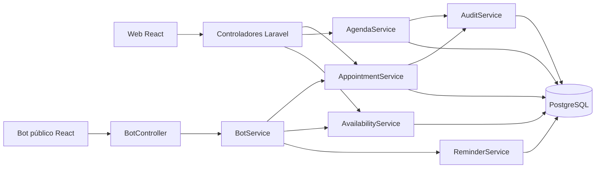

# Arquitectura

Monolito modular Laravel + React/TypeScript, unido por Inertia. PostgreSQL es la única persistencia de negocio; React no guarda reservas en localStorage ni accede a la base directamente.

`AuthController` autentica pacientes por tipo/número de documento y contraseña; las cuentas anteriores y administradores conservan acceso por alias. El registro público crea exclusivamente usuarios con rol paciente. `RoleMiddleware`, `AppointmentPolicy` y los servicios protegen las operaciones en servidor. `IdleSession` y el contexto anónimo del bot limitan inactividad a 900 segundos; el almacenamiento de sesiones también dura 15 minutos. Cookies HttpOnly/SameSite, CSRF Laravel, validación y salida escapada completan los controles básicos. Los formularios nunca asignan un rol administrativo.

`AvailabilityService` devuelve consultas basadas en `Slot::available`: futuro, habilitado, servicio habilitado y ausencia de reserva confirmada. Web y bot comparten esa regla. Los filtros por fecha se interpretan en America/Bogota, fijada tanto en Laravel como en la conexión PostgreSQL; la interfaz usa explícitamente la misma zona.

## Modelo

| Documento maestro | Implementación | Relaciones e integridad |
| --- | --- | --- |
| UsuarioPrueba / paciente | `users` / `User` | Alias técnico único, nombre, hash, rol; tipo y número de documento ficticio cifrado, clave HMAC única y fecha de activación web |
| Servicio | `services` / `Service` | Nombre, descripción, duración, habilitación |
| Franja | `slots` / `Slot` | Servicio FK, inicio/fin timestamptz, fin mayor a inicio, inicio único por servicio |
| Cita | `appointments` / `Appointment` | Usuario y franja FK, UUID código y solicitud únicos, CONFIRMADA/CANCELADA |
| EventoAuditoria | `audit_events` / `AuditEvent` | Actor FK, entidad, operación, antes/después JSONB, canal, fecha |
| MensajeSimulado | `simulated_messages` / `SimulatedMessage` | Usuario/cita FK, emisor, contenido sintético, opciones, evento único |

Las FK de negocio restringen borrado. No hay interfaz de eliminación de citas, auditoría o usuarios. Las citas canceladas conservan historial. No existe un estado de atención médica realizada.

## Operaciones críticas

Reserva: transacción; bloqueo del actor para serializar reintentos; búsqueda del UUID de solicitud; bloqueo de franja; comprobación vigente; inserción de cita y auditoría; commit. El índice parcial `one_active_appointment_per_slot` permite una única cita CONFIRMADA por franja, incluso ante un escritor que eluda el servicio. Cancelar permite volver a utilizar la franja sin eliminar citas anteriores.

Reprogramación: autorización; bloqueo de cita; bloqueo de franjas por orden de ID; validación de estado, futuro y mismo servicio; cambio de FK y auditoría dentro de la misma transacción. Un destino ocupado revierte todo y mantiene la reserva original. El código de cita no cambia.

Cancelación: confirmación explícita validada por HTTP; bloqueo de cita y franja; cambio de estado y auditoría. Una segunda cancelación devuelve la cita existente y no crea otro evento.

Agenda: solo administrador; bloqueo del servicio al crear para serializar detección de cruces; bloqueo de franja para habilitar o bloquear. Una cita activa impide bloquear la franja.

## Conversación y reportes

El estado conversacional queda en la sesión del usuario; la transcripción queda en PostgreSQL. Opciones de servicio, fecha, cita y franja se calculan de la base. El POST conversacional bloquea la sesión para evitar contextos simultáneos contradictorios. Confirmar de nuevo una operación terminada consulta el resultado sin ejecutarla otra vez. Se descarta texto libre desconocido antes de almacenarlo para no conservar información personal que se escriba accidentalmente.

El bot es uno de los dos canales principales. Usa un layout público independiente en `GET /bot` y `POST /bot`, fuera del middleware `auth`; no exige autenticación web ni registro previo. `BotController` guía la identificación mediante tipo de documento, identificador sintético con prefijo LAB o FICT (por ejemplo LAB000001), nombre de prueba y clave. Se rechazan números de documento sin ese prefijo tanto en bot como en registro/acceso web. Los campos de identificación y claves no se escriben en la transcripción. La clave se confirma y almacena como hash, y los datos pendientes quedan en la sesión cifrada. Para perfiles existentes, conocer el identificador no revela nombre, mensajes ni citas hasta verificar la clave. El contexto verificado conserva el ID del paciente y su actividad; al salir o expirar se descarta. Una sesión web de paciente vigente puede entrar directamente, pero salir del bot exige volver a identificarse dentro del chat y no cierra la sesión del portal.

`PatientIdentityService` normaliza el número, calcula HMAC-SHA256 con la clave de la aplicación y exige unicidad de tipo/número. El número completo se cifra mediante un cast de Eloquent y se oculta de la serialización. No se debe cambiar APP_KEY sin el procedimiento de conservación y migración de datos cifrados. `RegistrationController` activa la web en el mismo `users.id`, preservando las FK de citas, auditoría y mensajes. Desde otro contexto exige la clave previa; no basta presentar el documento. No se hace validación oficial de identidad ni se gestiona una transición automática TI→CC.

La migración `2026_11_12_000002_add_patient_identity_to_users` agrega columnas opcionales; no borra las cuentas, citas ni agendas existentes. Los límites de solicitudes de chat, cambio de identidad y registro usan claves distintas para no bloquear un registro después de conversar.

`BotService` devuelve el estado y el mensaje/opciones actuales que se guardan en `session.bot.prompt`, asociados a `bot_actor_id`. Una sesión sin ese estado o con otro actor inicia un menú nuevo. React usa la prop `current`, nunca las opciones históricas de `simulated_messages`, para dibujar los botones activos. Si otra conversación ha escrito el último mensaje del historial, se repite al final el mensaje vigente de esta sesión. Un recordatorio no cambia las acciones disponibles. Cada envío de la interfaz incluye `prompt_id`: una acción de una pestaña antigua se rechaza sin mutaciones si su mensaje ya no coincide. Los consumidores HTTP de laboratorio que no mandan ese campo siguen sujetos a estado, políticas y servicios; el identificador del mensaje no es una credencial. El historial del navegador se refresca contra el servidor al volver a Bot y se limpia al salir/resetear el contexto.

Los comandos `menú`, `menu`, `0` y `salir` se interpretan antes de capturar cualquier campo de identificación, incluso durante la clave. Menú descarta la identificación pendiente y vuelve al comienzo; 0/salir ocultan identidad e historial y dejan una opción explícita para iniciar de nuevo. Una entrada guiada desconocida descarta una confirmación pendiente y ofrece volver/salir, sin crear ni modificar citas.

El compositor se deshabilita durante el envío. Su formulario usa una fábrica de valores iniciales vacíos: `reset()` nunca restaura documentos, nombres o claves enviados previamente, aunque Inertia actualice sus valores por defecto tras una respuesta correcta.

`ReminderService` acepta un reloj configurable. La identidad del recordatorio incluye cita/franja/inicio; un cambio a otro horario constituye otro evento. Son eventos internos de PostgreSQL, consultables a demanda; no hay programación periódica ni envío externo.

La identificación de laboratorio no acredita identidad civil. El prefijo sintético limita el formato admitido, pero no verifica nombres ni impide que alguien escriba datos personales deliberadamente. La clave limita el acceso a perfiles existentes (cinco fallos por paciente/IP/minuto), pero no certifica la titularidad de un perfil nuevo. No hay recuperación de claves, segundo factor, prueba documental ni verificación con Registraduría. No debe usarse con pacientes reales. Detalles y pruebas: [RF10_PUBLIC_BOT.md](RF10_PUBLIC_BOT.md).

Los reportes cuentan filas de citas según la fecha actualmente programada de su franja, servicio y estado. Una reprogramación mueve la cita al nuevo periodo; no se pretende reconstruir un estado histórico de reporte. Auditoría sí conserva el cambio. CSV exporta exactamente los agregados visibles; no incluye identidades ni secretos.
